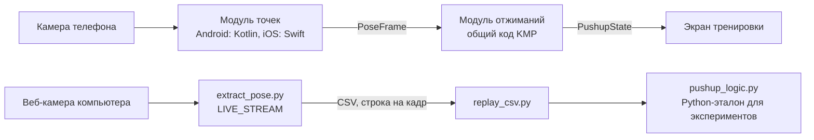

# Счётчик отжиманий: модули, данные и эксперименты

Предлагаем разделить систему на два модуля: **модуль точек** (камера → 12 точек тела) и **модуль отжиманий** (точки → повторы, подсказки, ошибки). Между ними один формат кадра: `PoseFrame`. На компьютере он же лежит в CSV, по строке на кадр.

- Каждую тренировку записываем с камеры один раз, а формулы и коэффициенты перебираем по готовым CSV за секунды (`replay_csv.py`).
- Нестабильную детекцию чистим в начале модуля отжиманий, а CSV остаётся «сырым». Поэтому очистку тоже можно подбирать экспериментами.
- Модуль отжиманий в приложении один: на Kotlin в общем коде KMP. Логику и параметры подбираем на его Python-версии (`pushup_logic.py`), а мобильщики переносят их в Kotlin. Обе версии сверяем на одних и тех же CSV.

Финальный контракт для мобильщиков лежит в документе [Контракт данных](data_contract.md), выбор модели описан в документе [Сравнение моделей распознавания позы](model_choice.md).

## Два модуля



Модуль точек: единственное место, где есть камера и MediaPipe. Его пишут мобильщики отдельно для Android и для iOS, но выдаёт он одно и то же: `PoseFrame`. Модуль отжиманий получает только эти кадры и живёт в общем коде KMP. На компьютере модуль точек заменяет `extract_pose.py`: он работает с веб-камерой в том же режиме LIVE\_STREAM, что и телефон, и пишет те же `PoseFrame` в CSV.

## Плюсы и минусы разделения

Плюсов больше, а все минусы закрываются правилами из этого документа и контракта.

**Плюсы**

- Быстрые эксперименты: самая долгая часть (запись с MediaPipe) делается один раз, а вариант формулы проверяется по CSV за секунды.
- Честное сравнение: все варианты считают по одним и тем же точкам, поэтому разница в результате получается из-за формулы, а не из-за случайности модели.
- Работа делится чисто: мобильщики делают модуль точек и переносят модуль отжиманий на Kotlin, ML-инженер и аналитик подбирают логику модуля отжиманий на Python. Договариваться нужно только о формате `PoseFrame`.
- Одна логика на две платформы: модуль отжиманий лежит в общем коде KMP и считает одинаково на Android и iOS.
- Модель можно поменять (lite на full, MediaPipe на ML Kit), не трогая подсчёт.

**Минусы и что с ними делаем**

- Нужен строгий контракт. Любое изменение формата означает новую версию контракта и сообщение всей команде.
- Модуль отжиманий существует в двух версиях: Python для экспериментов и Kotlin в приложении. Их расхождение ловим сверкой: обе версии на одних CSV должны дать одинаковый счёт.
- Модуль отжиманий не видит картинку, только точки. Если понадобится что-то ещё (например, яркость кадра), это поле добавляем в `PoseFrame` через новую версию контракта.
- В режиме LIVE\_STREAM модель пропускает кадры, пока занята, и на телефоне, и на компьютере, а частота кадров у разных устройств разная. Поэтому все окна в модуле отжиманий считаем в миллисекундах, а не в кадрах.

## Как очищаем точки перед подсчётом

Детекция дрожит и иногда пропадает, поэтому первым делом модуль отжиманий чистит точки. Главное правило: очистка смотрит только на прошлые кадры. Телефон считает вживую и не знает будущего, а Python-версия должна вести себя так же, иначе подобранные на CSV параметры не перенесутся на телефон.

1. **Проверка кадра.** Если человек не найден или нужные точки видны хуже порога `MIN_VIS` (сейчас 0,5), у кадра нет значения сигнала.
2. **Короткие пропуски.** Если значения нет недолго, держим последнее хорошее. Дольше порога (его подбираем) считаем, что человек вышел из кадра, и ничего не засчитываем, пока он не вернётся.
3. **Скачки.** Если сигнал за один кадр изменился слишком сильно (больше заданной доли ширины плеч), считаем кадр ошибкой модели и пропускаем его.
4. **Сглаживание.** Сейчас это медиана последних 5 значений. Кандидаты на замену: экспоненциальное сглаживание с коэффициентом α и фильтр One Euro. Он сильно сглаживает дрожание на месте и слабо сглаживает быстрые движения, поэтому меньше опаздывает.
5. **Нормировка.** Делим на ширину плеч, чтобы не зависеть от расстояния до камеры. Ширина плеч тоже дрожит, поэтому её можно брать сглаженной.
6. **Время вместо кадров.** Все окна (сглаживание, поиск «верха», удержание пропуска) задаём в миллисекундах по `time_ms`. Сейчас «верх» ищем за 150 кадров с сигналом (кадр без сигнала окно не сдвигает), а 150 кадров занимают разное время: кадры идут неравномерно.

Шагов 2, 3 и 6 в нашем коде пока нет. Параметры шагов с 1 по 5 выбираем экспериментами из таблицы ниже.

## Как работаем с CSV

CSV хранит сырой выход модуля точек: одна строка на обработанный кадр, один файл на запись. Кадры, которые модель пропустила, в файл не попадают, поэтому номера в колонке `frame` идут с пропусками.

- Файл никогда не правим и не чистим «на месте». Вся очистка происходит внутри модуля отжиманий, с параметрами эксперимента. Так одни и те же CSV годятся для любого варианта.
- Кадр без человека остаётся строкой с `detected = 0` и пустыми клетками. Не удаляем: пропуск тоже несёт информацию для очистки.
- Ось времени: `time_ms`, а не номер кадра.
- CSV от разных моделей лежат в разных папках (`output/csv/full/`, `output/csv/lite/`), а рядом в `.meta.json` записано, какой моделью и с какой скоростью они получены.
- Если меняем модуль точек (модель, пороги MediaPipe), старые CSV для сравнения не годятся: делаем новые записи. Если меняем только модуль отжиманий, CSV не трогаем.
- Формат строки совпадает с `PoseFrame` из контракта: 6 служебных колонок и по 5 на каждую из 12 точек, всего 66. Телефон в режиме отладки пишет такие же строки, и `replay_csv.py` считает по ним так же, как по компьютерным.

## Эксперименты: данные и метрики

Эксперимент сравнивает варианты модуля отжиманий на размеченных записях с камеры. Разметка лежит в `data/labels.csv`, по строке на запись: сколько отжиманий было на самом деле, ракурс, свет, кто снят и каким хватом (колонка `grip`).

**Данные делим на две части по людям:**

- настроечные записи: на них подбираем параметры;
- контрольные: один-два человека, которых нет в настроечных. На них проверяем только финальный вариант, один раз.

`replay_csv.py` считает метрики по всем записям из папки, которую ему дали, и колонку `person` не читает. Поэтому контрольные записи держим в отдельной папке (например `output/control/`) и не запускаем на ней скрипт, пока не выбран финальный вариант.

Если проверять на тех же людях, на которых подбирали, параметры подгоняются под них, и на новом человеке счётчик ошибается. Сбор самого набора записей и список краевых случаев: отдельная задача.

| Метрика | Как считаем | Зачем |
| --- | --- | --- |
| Ошибка счёта, повторов на запись | среднее по записям от \|насчитано − на самом деле\| | главная метрика: по ней выбираем вариант |
| Точные записи, % | доля записей, где счёт совпал полностью | понятна всем и удобна для отчёта |
| Лишние и пропущенные повторы | отдельно: сколько раз насчитал больше и сколько меньше | видно, в какую сторону ошибается вариант |
| Задержка засчёта, мс | от верхней точки подъёма до +1; нужна разметка моментов повторов | счётчик должен ощущаться «вживую» |
| Ложные подсказки, % кадров | доля кадров с подсказкой на хороших записях | подсказки не должны мигать без причины |
| Верная оценка хвата, % | доля оценённых повторов, где ошибка хвата совпала с разметкой `grip`, отдельно для классического, широкого и узкого; печатает `replay_csv.py` | ошибки техники (E8) |
| Ложные ошибки хвата на экране, % кадров | доля кадров с человеком, где на экране ошибка хвата, на записях с классическим хватом; печатает `replay_csv.py` | окно `GRIP_WINDOW` (E8) |
| Скорость, кадров/с | `processing_fps` из `.meta.json` | только для выбора модели; на компьютере модель не может обработать больше кадров, чем даёт камера, поэтому разница видна, только если модель медленнее камеры. Главное сравнение на телефонах |

Вариант выбираем по ошибке счёта. При равенстве смотрим на точные записи, потом на задержку, а если и там равно, берём вариант проще.

## Эксперименты: что подбираем

Восемь экспериментов по порядку работы модуля. Первые пять идут по готовым CSV за секунды. Для E6 нужны новые записи с каждой моделью: одно и то же движение дважды не записать, поэтому модели сравниваем на разных записях, и их нужно больше.

| № | Что подбираем | Варианты | Смотрим на |
| --- | --- | --- | --- |
| E1 | Очистка: порог видимости, удержание пропуска, порог скачка | `MIN_VIS` 0,3 / 0,5 / 0,7; удержание 0 / 100 / 200 / 300 мс; скачок 0,3 / 0,5 / 1 ширины плеч за кадр | ошибку счёта на записях с плохим светом и выходом из кадра |
| E2 | Сглаживание | медиана за 3 / 5 / 7 / 9 значений; экспоненциальное с α = 0,2 / 0,3 / 0,5 / 0,7; One Euro: min\_cutoff 0,5 / 1 / 2 и beta 0 / 0,01 / 0,05 | ошибку счёта и задержку |
| E3 | Формула сигнала | см. список под таблицей | ошибку счёта и точные записи |
| E4 | Пороги «внизу» и «вверху» | `DOWN_LEVEL` от 0,45 до 0,65 и `UP_LEVEL` от 0,75 до 0,9, шаг 0,05 | лишние и пропущенные повторы |
| E5 | Как ищем «верх» | максимум за 2 / 3 / 5 / 8 с; 95-й перцентиль за то же время | ошибку на записях с паузами и медленными повторами |
| E6 | Модель и пороги MediaPipe | lite / full / heavy; min\_pose\_detection\_confidence и min\_tracking\_confidence 0,3 / 0,5 / 0,7 | ошибку счёта и скорость |
| E7 | Подсказки | «слишком далеко» от 0,10 до 0,15 ширины кадра; «слишком близко» от 0,6 до 0,8 | ложные подсказки |
| E8 | Ошибки хвата | `GRIP_NARROW` от 0,9 до 1,2 и `GRIP_WIDE` от 1,8 до 2,4, шаг 0,1; `GRIP_WINDOW` 10 / 15 / 30 кадров | пороги: доля повторов с верной оценкой хвата на записях, где хват размечен (колонка `grip` в `data/labels.csv`), отдельно для классического, широкого и узкого; окно: доля кадров с ложной ошибкой на экране при классическом хвате |

**Формулы сигнала для E3:**

1. Высота плеч над запястьями, делённая на ширину плеч (как сейчас).
2. Та же высота, делённая на длину руки (плечо → локоть → запястье). Ширина плеч меняется, когда человек чуть повёрнут, а длина руки меняется меньше.
3. Угол в локтях. Спереди он неточный, но его стоит сравнить на цифрах.
4. Рост ширины плеч в кадре. Камера лежит на полу, и внизу отжимания плечи ближе к ней, значит кажутся шире.
5. Среднее двух лучших сигналов.

Порядок: E1 → E2 → E3 → E4 → E5, потом E6, E7 и E8. Каждый эксперимент берёт лучшие значения предыдущих. Пока окна счётчика в кадрах, порядок временный: E2 (медиана и экспоненциальное сглаживание), E3, E4, E7, E8, а после перевода окон в миллисекунды E1, E5 и фильтр One Euro из E2 (ему нужно время между кадрами). В конце два-три лучших варианта перепроверяем вместе, потому что параметры влияют друг на друга. Из ошибок техники пока есть только хват (E8): для него нужны записи, сделанные целиком одним хватом, классическим, широким или узким, с колонкой `grip` в разметке. Для остальных ошибок сначала нужна разметка, где и какая ошибка была.

## Как проводим и записываем эксперимент

1. Пишем гипотезу одной фразой: что меняем и чего ждём. Например: «экспоненциальное сглаживание с α = 0,3 уберёт лишние повторы на записях с дрожанием».
2. Меняем один параметр. Всё остальное оставляем как в текущем лучшем варианте, его называем «базовым».
3. Прогоняем вариант по всем настроечным записям (`python replay_csv.py <папка с настроечными записями>`) и считаем метрики.
4. Записываем строку в журнал, даже если стало хуже: отрицательный результат не придётся проверять второй раз.
5. Если вариант лучше базового по ошибке счёта, он становится новым базовым.
6. В самом конце финальный вариант один раз проверяем на контрольных записях. Если там ошибка намного больше, чем на настроечных, параметры подогнаны под знакомых людей, и лучше вернуться к варианту проще.
7. Принятые параметры мобильщики переносят в Kotlin, затем делаем сверку: на тех же CSV Kotlin-версия должна дать тот же счёт, что Python.

Журнал ведём в файле `data/experiments.csv` в репозитории, одна строка на запуск. Номер запуска состоит из номера эксперимента из таблицы выше и порядкового номера (E2-03 значит третий запуск сглаживания).

```csv
id,дата,кто,гипотеза,что поменяли,базовый,ошибка_счёта,точные_%,задержка_мс,вывод
E2-03,…,…,α = 0.3 уберёт лишние повторы,сглаживание EMA α = 0.3,E2-01,…,…,…,принят или отклонён
```

Если в тексте клетки есть запятая, весь текст клетки бери в двойные кавычки: `"медиана, окно 7"`. Числа пиши через точку. Правь файл в PyCharm или Блокноте, не в Excel.

## Что дальше

- [ ] Обсудить с командой разделение на два модуля и согласовать контракт.
- [ ] Собрать и разметить набор записей с камеры: краевые случаи и инструкция для съёмки.
- [ ] ML-инженер: в Python-версии перевести окна счётчика из кадров в миллисекунды и добавить шаги очистки 2 и 3. До этого аналитик проводит E2 (медиана и экспоненциальное сглаживание), E3, E4, E7 и E8 на текущем коде.
- [ ] Провести эксперименты с E1 по E5 и записать их в журнал.
- [ ] Мобильщики переносят модуль отжиманий в общий Kotlin-код, потом сверка на CSV.
- [ ] Проверить модели lite и full на телефонах команды (E6).
